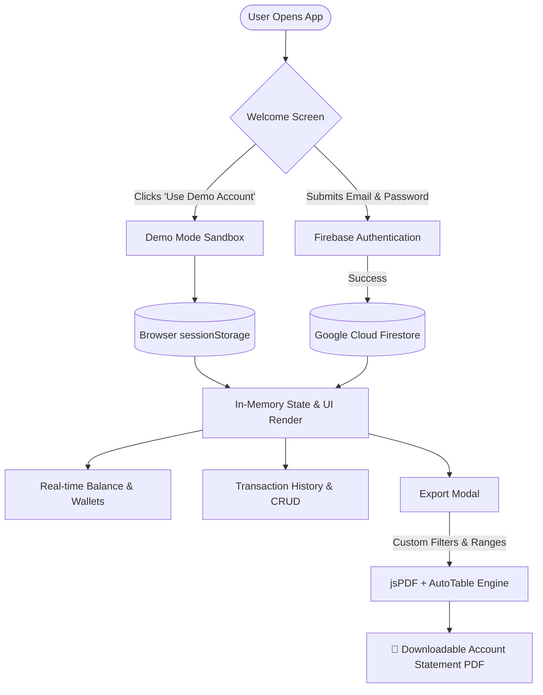

<div align="center">

# 💳 Digital Passbook

### A Sleek, Mobile-First Personal Finance & Multi-Wallet Expense Tracker

[](LICENSE)
[](script.js)
[](index.html)
[](style.css)
[](https://firebase.google.com/)
[](https://github.com/parallax/jsPDF)

<p align="center">
  <b>Digital Passbook</b> is a lightweight, mobile-first web application designed to track your daily income, expenses, and balances across multiple wallets seamlessly. Featuring instant sandbox <b>Demo Mode</b>, cloud sync via <b>Firebase</b>, and executive <b>PDF statement exports</b> with granular filters.
</p>

[Key Features](#-key-features) •
[Live Architecture](#-architecture--data-flow) •
[Quick Start](#-quick-start) •
[Firebase Setup](#-firebase-configuration) •
[PDF Export Engine](#-bank-grade-pdf-statement-generator) •
[Roadmap](#-roadmap)

---

</div>

## 🌟 Overview

Managing personal finances often feels overwhelming when juggling multiple payment apps, bank accounts, and cash. **Digital Passbook** simplifies this with a clean, app-like interface inspired by modern mobile banking applications.

It works out-of-the-box with **zero configuration** in **Demo Mode**, while offering secure cloud persistence for personal use via **Firebase Auth & Firestore**.

---

## ✨ Key Features

### 1. 💳 Dynamic Multi-Wallet Management
- Organize finances across multiple sources (e.g. `Cash`, `Paytm`, `FamPay`, `Bank Account`, or custom wallets).
- Live calculation of balance per wallet as transactions are recorded.
- Add new wallets on-the-fly or remove obsolete ones with one click.

### 2. 🏷️ Custom Categories with Emoji Icons
- Built-in categories for Income (💰 *Salary*, 💵 *Allowance*, 🎁 *Gift*) and Expense (🍔 *Food*, 🛍️ *Shopping*, 🚕 *Travel*, 🧾 *Bills*).
- Create custom categories with custom names and your favorite emoji in seconds.

### 3. ⚡ Real-Time Financial Dashboard
- **Total Balance**: Live net balance calculated instantly (`Income - Expense`).
- **Income & Expense Metrics**: Clear breakdown of overall cash inflow and outflow.
- **Wallet Carousel Cards**: Distinct visual color coding for each financial account.

### 4. 📝 Comprehensive Transaction Management (CRUD)
- **Fast Entry**: Intuitive form with type toggle (Income/Expense), date picker, amount, wallet, and category selection.
- **Inline Editing**: Modify any transaction's details with pre-filled inputs.
- **Bulk Operations**: Select individual entries or use **Select All** to perform batch deletions with confirmation.

### 5. 📄 Bank-Grade PDF Statement Generator
- Export professional, beautifully formatted financial statements powered by `jsPDF` and `AutoTable`.
- **Timeframe Filtering**:
  - Last 1 Month, 3 Months, 6 Months, 1 Year, All Time, or **Custom Date Range** (Start Date to End Date).
- **Type Filtering**: Export *Both*, *Expenses Only*, or *Income Only*.
- **Multi-Select Filters**: Filter by specific wallets and categories simultaneously.
- **Statement Structure**:
  - Professional header with generation date and active filter summaries.
  - Financial summary banner highlighting Total Income, Total Expense, and Net Balance.
  - Detailed striped ledger table with color-coded credits (`+ Green`) and debits (`- Red`).
  - Automatic page numbering and footer tags.

### 6. 🔒 Dual Architecture (Demo Mode vs. Admin Mode)
- **Demo Mode**:
  - Instant access with one click — no login or account creation required.
  - Uses browser `sessionStorage` for temporary, completely isolated data.
  - Safe for public testing and demonstrations without exposing personal data.
- **Admin Mode**:
  - Secure authentication via Firebase Email & Password.
  - Persistent real-time cloud sync with Cloud Firestore.
  - Access your ledger from any smartphone, tablet, or PC.

---

## 🏗️ Architecture & Data Flow



---

## 🛠️ Technology Stack

| Component | Technology | Description |
| :--- | :--- | :--- |
| **Frontend Core** | HTML5, Modern CSS3 | Semantic markup and native CSS variables |
| **Logic & State** | Vanilla JavaScript (ES6+) | Lightweight, reactive DOM updates with zero framework overhead |
| **Cloud Database** | Firebase Cloud Firestore v8 | NoSQL real-time cloud database |
| **Authentication** | Firebase Auth | Secure Email/Password credentials |
| **PDF Generation** | jsPDF & jsPDF-AutoTable | Client-side vector PDF rendering and table generation |
| **Icons & Fonts** | FontAwesome 6 & Segoe UI | Clean iconography and typography |
| **Hosting Ready** | Firebase Hosting | Production deployment configuration included |

---

## 🚀 Quick Start

### Option A: Run Locally (Zero Setup)

You don't need Node.js or any build tools to run Digital Passbook locally.

1. **Clone the repository:**
   ```bash
   git clone https://github.com/dhruvil-114/web-passbook.git
   cd web-passbook
   ```

2. **Open `index.html`:**
   - Double click `index.html` to open directly in any modern web browser, or
   - Use VS Code extension **Live Server** (`Right click index.html -> Open with Live Server`).

3. Click **"Use Demo Account"** to test all features immediately!

---

### Option B: Cloud Sync with Firebase (Admin Mode)

To enable multi-device cloud synchronization for your own private use:

#### 1. Create a Firebase Project
1. Go to the [Firebase Console](https://console.firebase.google.com/) and click **Add Project**.
2. Name your project (e.g., `my-digital-passbook`) and create it.

#### 2. Enable Authentication
1. Navigate to **Build > Authentication** in the sidebar.
2. Click **Get Started**, choose **Email/Password**, and enable it.
3. Under the **Users** tab, click **Add User** and create your Admin credentials (email and password).

#### 3. Enable Cloud Firestore
1. Navigate to **Build > Firestore Database** and click **Create database**.
2. Select your preferred server location.
3. Go to the **Rules** tab and paste the security rules:
   ```javascript
   rules_version = '2';
   service cloud.firestore {
     match /databases/{database}/documents {
       match /{document=**} {
         // Allow read & write only to authenticated users
         allow read, write: if request.auth != null;
       }
     }
   }
   ```
4. Click **Publish**.

#### 4. Configure `script.js`
1. In Firebase Console, go to **Project Settings** (gear icon) > **General**.
2. Under *Your apps*, click the **Web** icon (`</>`) to register your app.
3. Copy your `firebaseConfig` object and replace the placeholder in `script.js`:
   ```javascript
   const firebaseConfig = {
       apiKey: "YOUR_API_KEY",
       authDomain: "your-project.firebaseapp.com",
       projectId: "your-project-id",
       storageBucket: "your-project.appspot.com",
       messagingSenderId: "YOUR_MESSAGING_SENDER_ID",
       appId: "YOUR_APP_ID"
   };
   ```

#### 5. Deploy to Firebase Hosting (Optional)
```bash
npm install -g firebase-tools
firebase login
firebase init hosting
firebase deploy
```

---

## 📂 Project Structure

```text
web-passbook/
├── .firebaserc             # Firebase active project configuration
├── .gitignore              # Files and patterns ignored by Git
├── CONTRIBUTING.md         # Guidelines for open source contributors
├── LICENSE                 # MIT Open Source License
├── README.md               # Complete project documentation
├── firebase.json           # Firebase hosting & Firestore routing rules
├── firestore.indexes.json  # Firestore query indexes
├── firestore.rules         # Database security access rules
├── index.html              # Main application template & modal views
├── script.js               # Application logic, state management & PDF engine
└── style.css               # Mobile-first stylesheet & UI themes
```

---

## 📄 Bank-Grade PDF Statement Generator

The built-in statement generator produces clear financial records suitable for tax prep, budgeting reviews, or personal bookkeeping:

```text
+--------------------------------------------------------------------------+
|  Account Statement                                                       |
|  Generated on: 12 Nov 2026  |  Period: 01 Oct 2026 to 12 Nov 2026        |
|  Filters applied: Type: ALL | Wallets: Cash, Paytm                       |
|--------------------------------------------------------------------------|
|  [ Total Income: Rs. 45,000 ]  [ Total Expense: Rs. 18,200 ]  [ Net: +26,800 ] |
|--------------------------------------------------------------------------|
| Date        | Description       | Category  | Source | Income (Rs) | Expense (Rs) |
|-------------+-------------------+-----------+--------+-------------+--------------|
| 01 Nov 2026 | Monthly Salary    | Salary    | Bank   |   45,000.00 |              |
| 03 Nov 2026 | Grocery Mart      | Shopping  | Cash   |             |     2,450.00 |
| 05 Nov 2026 | Electricity Bill  | Bills     | Paytm  |             |     1,800.00 |
+--------------------------------------------------------------------------+
| Page 1 of 1                                Generated by Digital Passbook |
+--------------------------------------------------------------------------+
```

---

## 🛡️ Security & Privacy

- **Zero Data Leakage in Demo Mode**: Demo mode uses `sessionStorage`, meaning test data disappears when the tab closes and is never transmitted over any network.
- **Strict Firestore Authorization**: Firestore rules require valid user authentication tokens (`request.auth != null`). Unauthorized visitors cannot read or write data.
- **No Sensitive Credential Tracking**: Repository files use environment-agnostic placeholders, ensuring your production secrets remain private.

---

## 🗺️ Roadmap

- [x] Multi-wallet dynamic balance tracking
- [x] Custom categories with emoji support
- [x] Granular PDF statement generator with custom date ranges
- [x] Temporary isolated Demo Mode + Cloud Admin Mode
- [ ] 🌙 Dark Mode / High Contrast Theme toggle
- [ ] 📊 Monthly analytics charts (Income vs Expense breakdown via Chart.js)
- [ ] 📥 Export to Excel / CSV format
- [ ] 🔁 Recurring expenses & bill reminders
- [ ] 💱 Multi-currency selector (₹, $, €, £, ¥)

---

## 🤝 Contributing

Contributions, issues, and feature suggestions are always welcome!  
Please review the [Contributing Guidelines](CONTRIBUTING.md) to get started.

1. Fork the Project
2. Create your Feature Branch (`git checkout -b feature/AmazingFeature`)
3. Commit your Changes (`git commit -m 'feat: Add AmazingFeature'`)
4. Push to the Branch (`git push origin feature/AmazingFeature`)
5. Open a Pull Request

---

## 📜 License

This project is licensed under the **MIT License** - see the [LICENSE](LICENSE) file for details.

---

## 👨‍💻 Author

**Dhruvil Patel**
- GitHub: [@dhruvil-114](https://github.com/dhruvil-114)

---

<div align="center">
  <sub>Built with ❤️ for simple, stress-free personal finance management.</sub>
</div>
